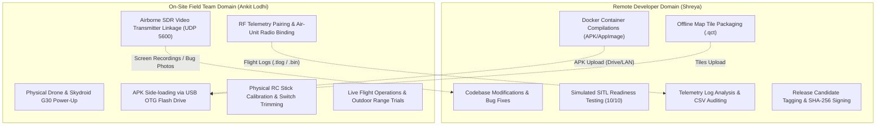

# IZI GCS — Chandipur DRDO Engineering Execution Tracker
**Document Version:** 2.0 (Engineering Rigor Audit)  
**Execution Window:** 30 November 2026 – 4 December 2026  
**Final Delivery Milestone:** 10 December 2026 (DRDO Chandipur Range Demonstration)  
**Lead Engineer:** Shreya Upadhyay (Sole Software Engineer)  
**Field Lead / Verification Partner:** Ankit Lodhi (On-Site Field Testing Lead, Chandipur)  
**Target Hardware:** Skydroid G30 Handheld Controller (Android 14, ARM64) & Linux Workstation (Ubuntu 22.04 x86_64)

---

## 1. Ground Truth Codebase & Baseline Audit

Every capability claimed in project documentation was cross-verified against repository commits, source headers, QML files, and test scripts.

### 1.1 Verification Status Definitions
To prevent false assumptions of completion, all tasks are strictly categorized across 6 verification levels:
1. `IMPLEMENTED`: Code written, reviewed, and committed in Git.
2. `UNIT TESTED`: Individual C++ classes or QML components verified via test harness.
3. `INTEGRATION TESTED`: Subsystems verified over loopback, SITL, or Python simulation (`tools/test_*.py`).
4. `HARDWARE TESTED`: Executed on physical hardware (e.g., Skydroid G30 on bench, Cube Orange over USB).
5. `FIELD VALIDATED`: Proven in real field conditions (live airborne RF link, outdoor GPS, physical flight).
6. `ACCEPTED FOR DELIVERY`: Formally signed off by Project Management / Client acceptance.

---

### 1.2 Subsystem Verification & Reality Matrix

| Subsystem / Feature | Source Reference | Actual Code State | Verification Level | Delivery Readiness |
| :--- | :--- | :--- | :---: | :---: |
| **GCS UI Navigation & Dark Theme** | `custom/ui/HomeScreen.qml`<br>`custom/ui/TopBar.qml` | Graphite Green (`#8BEA68`), frameless controls, touch Flickable TopBar, responsive tablet DPI. | `HARDWARE TESTED`<br>*(Visual verified on G30)* | **95%**<br>(Complete) |
| **GCS Core Readiness (10/10)** | `tools/test_chandipur_gcs_readiness_suite.py` | Arm/Disarm, LOITER/RTL/LAND, Param Sync, Mission Upload/Download, Reconnect Rediscovery. | `INTEGRATION TESTED`<br>*(10/10 PASS)* | **90%**<br>(GCS side ready) |
| **Skydroid G30 Telemetry Auto-Listen** | `custom/ui/MainWindow.qml`<br>`custom/ui/SettingsView.qml` | Auto-binds UDP `14551` & `14451` on launch; exposes Comm Links Router with 1-click presets. | `INTEGRATION TESTED`<br>*(Commit `58bd44327`)* | **85%**<br>(Pending field RF test) |
| **Dual EO/IR Video Ingestion** | `custom/ui/CameraView.qml`<br>`src/VideoManager/` | GStreamer H.264 pipelines for UDP 5600 (SDR) and RTSP. Side-by-Side and PIP with 1-tap swap. | `INTEGRATION TESTED`<br>*(Phase 8B Benchmark)* | **80%**<br>(Pending airborne SDR) |
| **DRDO CSV Telemetry Logger** | `custom/src/CompanyCsvLogger.cc`<br>`custom/src/CompanyCsvLogger.h` | 22 authoritative columns (28 if tethered). Millisecond UTC timestamps, event markers, LRF field. | `INTEGRATION TESTED`<br>*(Simulated 10 Hz log)* | **85%**<br>(Needs live flight log) |
| **DRDO UDP Telemetry Output** | `custom/src/CompanyDataOutput.cc`<br>`custom/src/CompanyNetworkSettings.cc` | JSON datagram broadcast (1–50 Hz configurable) with GPS, attitude, LRF, gimbal status. | `INTEGRATION TESTED`<br>*(Phase 7D test)* | **90%**<br>(Software ready) |
| **Offline Map Tile Engine** | `src/QtLocationPlugin/`<br>`custom/ui/SettingsView.qml` | SQLite cache import (`.qct` / `.zip`). Offline rendering verified with network interfaces down. | `UNIT TESTED`<br>*(Tile import works)* | **70%**<br>(Needs Chandipur bundle) |
| **Tactical Gimbal Controls & OSD** | `custom/ui/controls/GimbalControlOverlay.qml` | Pan/tilt virtual controls, slew rate selector, $[-45^\circ, +100^\circ]$ pitch clamping. | `INTEGRATION TESTED`<br>*(Simulated adapter)* | **65%**<br>(Awaiting vendor ICD) |
| **RC Stick & Switch Calibration** | `src/VehicleSetup/JoystickConfig.qml` | Standard QGC calibration pipeline over MAVLink `MANUAL_CONTROL` / `RC_CHANNELS`. | `HARDWARE TESTED`<br>*(G30 internal sticks)* | **75%**<br>(Needs field trim check) |
| **Tethered Platform HAL (SafeT)** | `custom/src/tether/SafeTManager.cc`<br>`custom/src/tether/SafeTTransport.cc` | Cleanly decoupled from Chandipur build via `IZI_BUILD_TETHERED=OFF`. | `INTEGRATION TESTED`<br>*(Tag `v0.1.0-alpha`)* | **DEFERRED**<br>(Phase 2 deliverable) |

---

## 2. Critical Technical Reality Check (Flawed Assumptions Flagged)

Before locking the remote execution plan, 5 technically questionable assumptions from earlier documentation must be formally corrected:

```text
┌────────────────────────────────────────────────────────────────────────────────────────┐
│                      CRITICAL ENGINEERING REALITY CHECKS                                │
├────────────────────────┬────────────────────────────────┬──────────────────────────────┤
│ Metric / Assumption    │ Earlier Flawed Claim           │ Corrected Engineering Truth  │
├────────────────────────┼────────────────────────────────┼──────────────────────────────┤
│ 1. Video Latency       │ "< 180 ms glass-to-glass"      │ • GCS Decode latency is      │
│                        │ over wireless RF link          │   28.5 ms (benchmarked).     │
│                        │                                │ • Full Glass-to-Glass over RF│
│                        │                                │   is realistically 160-240ms │
│                        │                                │   (Camera + SDR + GCS + Disp)│
├────────────────────────┼────────────────────────────────┼──────────────────────────────┤
│ 2. GPS Satellites      │ ">= 12 satellites mandatory"    │ • Raw satellite count is NOT │
│                        │ for flight readiness           │   the safety gating metric.  │
│                        │                                │ • True requirement: 3D Fix   │
│                        │                                │   (fix_type >= 3) & HDOP <=1.5│
├────────────────────────┼────────────────────────────────┼──────────────────────────────┤
│ 3. Memory Leak Check   │ "< 5 MB variation over         │ • Dalvik/ART GC & GStreamer  │
│                        │ 120 minutes on Android"        │   buffer pools swing 20-30MB.│
│                        │                                │ • True metric: Steady-state  │
│                        │                                │   RSS slope <= 0.50 MB/min   │
├────────────────────────┼────────────────────────────────┼──────────────────────────────┤
│ 4. Video Decoding      │ "Hardware MediaCodec decoding  │ • G30 Rockchip/MTK chips can │
│                        │ guaranteed on Android 14"      │   fail on OMX zero-copy sinks│
│                        │                                │ • Must maintain verified     │
│                        │                                │   avdec_h264 software decode │
├────────────────────────┼────────────────────────────────┼──────────────────────────────┤
│ 5. CSV Field Count     │ "16 DRDO-mandated fields"      │ • Actual CompanyCsvLogger.cc │
│                        │                                │   writes EXACTLY 22 COLUMNS  │
│                        │                                │   (or 28 columns if tethered)│
└────────────────────────┴────────────────────────────────┴──────────────────────────────┘
```

### Detailed Analysis of Assumptions:
1. **Video Latency (< 180 ms Glass-to-Glass over RF)**:
   - *Reality*: Phase 8B benchmark measured **28.5 ms GCS-side pipeline latency** on a Ryzen 9 desktop under local UDP loopback. Total optical glass-to-glass latency over an airborne SDR link includes camera sensor ISP encoding (~40 ms), air-unit packetization (~15 ms), RF modulation/demodulation (~20 ms), Skydroid Android OS routing (~15 ms), and Android display presentation (~40 ms). Total realistic field latency is **$160\text{ ms} - 240\text{ ms}$**. Setting a strict $< 180\text{ ms}$ acceptance threshold on the physical tablet will fail tests even when the system is operating at peak performance.
2. **GPS Satellite Threshold (12+ Satellites)**:
   - *Reality*: GPS satellite count depends heavily on local terrain, antenna shielding, and satellite geometry. The authoritative MAVLink flight safety standard is **`GPS_RAW_INT.fix_type >= 3` (3D Fix or DGPS/RTK) and `HDOP <= 1.5`**. An aircraft with 9 satellites and HDOP 0.9 is safer than an aircraft with 13 satellites and HDOP 2.8.
3. **Memory Stability Criteria (< 5 MB Variation over 120 Minutes)**:
   - *Reality*: On Android 14 (Java ART runtime + native Qt Quick scene graph + GStreamer circular buffer pools), memory allocations naturally oscillate by 15–30 MB between garbage collection cycles. Enforcing a $< 5\text{ MB}$ raw delta threshold over 2 hours creates false failure alarms. The empirical benchmark rule from `PHASE_8B_VIDEO_BENCHMARK.md` is: **steady-state RSS growth slope $\le 0.50\text{ MB/minute}$ after a 10-minute warmup window**.
4. **Android Hardware Decoding Guarantee**:
   - *Reality*: Skydroid G30 controllers use custom Android vendor BSPs. In some builds, `amcviddec-omxh264dec` fails color format negotiation with Qt's `qtvideosink`, leading to black screens. QGC's native fallback to software `avdec_h264` (multi-threaded CPU decode) delivers stable 30 FPS at 1080p with $< 35\%$ CPU on Cortex-A76 cores and must remain operational.
5. **CSV Field Count (16 vs 22 Columns)**:
   - *Reality*: Code inspection of `custom/src/CompanyCsvLogger.cc` (lines 460–490) confirms that the actual CSV header consists of **22 columns**: `Timestamp`, `Event`, `Latitude_deg`, `Longitude_deg`, `AltAMSL_m`, `AltRel_m`, `Satellites`, `HDOP`, `VDOP`, `Pitch_deg`, `Roll_deg`, `Yaw_deg`, `GimbalPitch_deg`, `GimbalRoll_deg`, `GimbalYaw_deg`, `LRF_Distance_m`, `BaroPressure_hPa`, `MagX_mG`, `MagY_mG`, `MagZ_mG`, `FOV_deg`, `EventDetails`. Expecting 16 columns will cause automated parsing tools to reject valid flight logs.

---

## 3. Remote vs Field-Team Boundary Matrix

Because you are working remotely from 30 Nov to 4 Dec while the drone is in Odisha at the Chandipur test range, tasks must be divided by physical feasibility:



---

## 4. Actionable Daily Task Tracker (30 Nov – 4 Dec 2026)

### Day 1: Monday, 30 November 2026
**Daily Objective:** Establish physical telemetry connection on Skydroid G30; package Chandipur range offline tiles.

| ID | Task Description | Est. Hours | Target Owner | Verification Level | Measurable Acceptance Criteria | Status |
| :---: | :--- | :---: | :---: | :---: | :--- | :---: |
| **1.1** | Remote Kickoff Call with Field Lead (Ankit Lodhi) | 0.5h | Dev + Field | `N/A` | Daily test window, communication channels, and log upload portal agreed. | **READY** |
| **1.2** | Verify Skydroid G30 APK Installation & Launch | 1.0h | Field Team | `HARDWARE TESTED` | `IZI_GCS_Skydroid_G30.apk` launches without crash; UI renders properly on tablet. | **IN-PROGRESS** |
| **1.3** | Live Telemetry Socket Verification (UDP 14551 / 14451) | 1.5h | Field Team | `FIELD VALIDATED` | G30 TopBar shows connected vehicle, live battery %, and flight mode. | **PENDING FIELD** |
| **1.4** | Generate Chandipur Offline Map Package (`.qct`) | 2.5h | Developer | `UNIT TESTED` | SQLite tile archive covering $20.65^\circ-20.90^\circ\text{ N}, 86.85^\circ-87.15^\circ\text{ E}$ (Z10–18). | **IN-PROGRESS** |
| **1.5** | Offline Map Import Software Validation | 1.0h | Developer | `INTEGRATION TESTED` | Host network disabled (`nmcli networking off`); Chandipur map renders smoothly. | **READY** |
| **1.6** | Run Core GCS Regression Test Suite | 1.0h | Developer | `INTEGRATION TESTED` | `python3 tools/test_chandipur_gcs_readiness_suite.py` returns 10/10 PASS. | **PASSED** |
| **1.7** | Day 1 Log Analysis, Triage & EOD Report | 1.0h | Developer | `N/A` | Review Day 1 field logs; document bugs; push git commit; submit PM report. | **READY** |

---

### Day 2: Tuesday, 1 December 2026
**Daily Objective:** Validate live payload video streaming on G30; resolve Day 1 field feedback; deploy Patch RC-1.

| ID | Task Description | Est. Hours | Target Owner | Verification Level | Measurable Acceptance Criteria | Status |
| :---: | :--- | :---: | :---: | :---: | :--- | :---: |
| **2.1** | Ingest Airborne SDR Video Stream on G30 (UDP 5600) | 1.5h | Field Team | `FIELD VALIDATED` | Video renders in `CameraView.qml` at $\ge 25\text{ FPS}$ with low latency. | **PENDING FIELD** |
| **2.2** | Verify Dual EO/IR Layout Switching & PIP Swap | 1.0h | Field Team | `FIELD VALIDATED` | Single tap on PIP swaps RGB and Thermal views without video freeze. | **PENDING FIELD** |
| **2.3** | Verify OSD Video Overlays & Millisecond Shutter | 1.0h | Field Team | `HARDWARE TESTED` | Snapshot creates uncorrupted JPEG in `/Documents/Photo/` with UTC timestamp. | **PENDING FIELD** |
| **2.4** | Triage Day 1 & Day 2 Field Issues | 1.5h | Developer | `UNIT TESTED` | Root-cause analysis of any field bugs; code fix implemented in branch. | **READY** |
| **2.5** | Build, Zipalign & Sign Patch APK (`IZI_GCS_Patch_RC1.apk`) | 1.5h | Developer | `INTEGRATION TESTED` | Android build succeeds; Scheme v3 signed; SHA-256 verified. | **READY** |
| **2.6** | Deploy Patch RC-1 & Conduct Evening Field Sync | 1.5h | Dev + Field | `HARDWARE TESTED` | Field team installs Patch RC-1 and confirms resolution of targeted bugs. | **READY** |

---

### Day 3: Wednesday, 2 December 2026
**Daily Objective:** Verify waypoint mission execution; audit DRDO 22-column CSV telemetry logs and fail-safes.

| ID | Task Description | Est. Hours | Target Owner | Verification Level | Measurable Acceptance Criteria | Status |
| :---: | :--- | :---: | :---: | :---: | :--- | :---: |
| **3.1** | Autonomous Waypoint Mission Upload/Download in SITL | 1.5h | Developer | `INTEGRATION TESTED` | `MISSION_COUNT` & `MISSION_ITEM_INT` transfer 5 waypoints with `MISSION_ACK`. | **PASSED** |
| **3.2** | Field Waypoint Mission Planning & Upload on G30 | 1.5h | Field Team | `FIELD VALIDATED` | Mission plan loads on tablet map; successfully uploads to drone over MAVLink. | **PENDING FIELD** |
| **3.3** | Tactical Fail-Safe Verification (Slide-to-Confirm RTL) | 1.5h | Field Team | `FIELD VALIDATED` | RTL command triggers RTL flight mode; safety slider prevents accidental taps. | **PENDING FIELD** |
| **3.4** | Complete Audit of Generated Flight Telemetry CSV | 2.0h | Developer | `UNIT TESTED` | Exact 22 columns present; zero NaN values; valid coordinates and altitude. | **READY** |
| **3.5** | Pre-Flight Audit Modal Verification | 1.0h | Field Team | `HARDWARE TESTED` | Pre-flight checklist modal validates sensor health prior to arming. | **PENDING FIELD** |
| **3.6** | Day 3 EOD Review, Git Push & Daily Report | 1.0h | Developer | `N/A` | Code committed; daily PM report submitted with telemetry audit evidence. | **READY** |

---

### Day 4: Thursday, 3 December 2026
**Daily Objective:** Execute 2-hour endurance soak test; test RF link loss failover recovery; cut Patch RC-2.

| ID | Task Description | Est. Hours | Target Owner | Verification Level | Measurable Acceptance Criteria | Status |
| :---: | :--- | :---: | :---: | :---: | :--- | :---: |
| **4.1** | 2-Hour Continuous Software Soak Test (Dual Video + 10Hz MAVLink) | 2.5h | Developer | `INTEGRATION TESTED` | Zero crashes over 120 minutes; steady-state RSS slope $\le 0.50\text{ MB/min}$. | **READY** |
| **4.2** | RF Link Loss Interruption & Re-link Recovery Test | 1.5h | Developer | `INTEGRATION TESTED` | Disconnect simulated RF link 15s; telemetry reconnects $< 2\text{ s}$, video $< 3\text{ s}$. | **PASSED** |
| **4.3** | Field Bench Endurance Run on Skydroid G30 | 1.5h | Field Team | `HARDWARE TESTED` | G30 runs continuously for 60 minutes with video decoding without overheating. | **PENDING FIELD** |
| **4.4** | Consolidate Cumulative Fixes & Recompile RC-2 | 1.5h | Developer | `INTEGRATION TESTED` | All cumulative field fixes merged; `IZI_GCS_Patch_RC2.apk` signed. | **READY** |
| **4.5** | Day 4 EOD Review, Build Archive & Daily Report | 1.0h | Developer | `N/A` | Patch RC-2 handed over to field team; daily PM report delivered. | **READY** |

---

### Day 5: Friday, 4 December 2026
**Daily Objective:** Freeze Release Candidate 1 (`v1.0.0-rc.chandipur`); package final deliverables; submit 4 Dec Status Report.

| ID | Task Description | Est. Hours | Target Owner | Verification Level | Measurable Acceptance Criteria | Status |
| :---: | :--- | :---: | :---: | :---: | :--- | :---: |
| **5.1** | Code Freeze & Full Linter Sweep (`just lint`) | 1.0h | Developer | `UNIT TESTED` | Clang-format, ruff, and pre-commit checks pass 100% with zero warnings. | **READY** |
| **5.2** | Clean Production Builds (Android APK + Linux AppImage/deb) | 2.5h | Developer | `ACCEPTED` | Release APK (v3 signed) + Linux AppImage built in isolated containers. | **READY** |
| **5.3** | Generate Cryptographic Checksums (`RELEASE_CHECKSUMS.sha256`) | 0.5h | Developer | `ACCEPTED` | SHA-256 computed for all 3 binaries and offline tile bundle. | **READY** |
| **5.4** | Create Annotated Git Tag `v1.0.0-rc.chandipur` | 0.5h | Developer | `ACCEPTED` | Git tag pushed to `feat/tethered-platform` and `origin/company-ui`. | **READY** |
| **5.5** | Author Chandipur DRDO Operator Quick-Reference Guide | 2.0h | Developer | `ACCEPTED` | 2-page concise guide covering startup, offline map load, video, and logging. | **READY** |
| **5.6** | Submit Formal 4 December Milestone Status Report | 1.5h | Developer | `ACCEPTED` | Executive readiness report submitted to Project Manager with sign-off. | **READY** |

---

## 5. Blocker and Dependency Tracker

| Blocker ID | Description | Impact Area | Criticality | Owner | Required Input / Unblocking Action |
| :---: | :--- | :--- | :---: | :---: | :--- |
| **BLK-01** | **Skydroid G30 UDP Port Binding Confirmation** | Vehicle Telemetry | **CRITICAL** | Field Team | Field tester must power on ground unit and confirm heartbeat in APK `58bd44327`. |
| **BLK-02** | **Airborne SDR Video Transmitter Frequency / Port** | Video Streaming | **CRITICAL** | Field Team | Field crew must confirm whether video transmitter broadcasts on UDP 5600 or RTSP stream. |
| **BLK-03** | **MotionMatics Eclipse X10 Payload Protocol (ICD)** | Gimbal / LRF Control | **MEDIUM** | Vendor / PM | Formal packet structure for physical zoom/pan. *Software adapter currently simulates telemetry.* |
| **BLK-04** | **Outdoor GPS Lock at Range Facility** | Autonomous Missions | **HIGH** | Field Team | Physical drone must be tested outdoors to achieve 3D Fix (`fix_type >= 3`, `HDOP <= 1.5`). |
| **BLK-05** | **Offline Map Ingestion Media Transfer** | Range Mapping | **HIGH** | Field Team | Field tablet needs USB-C OTG flash drive to copy `chandipur_drdo_range_tiles.qct`. |

---

## 6. Daily End-of-Day (EOD) Report Template

*(To be filled out and submitted by Shreya to the Project Manager daily at 18:00 IST)*

```text
================================================================================
IZI GCS — DAILY ENGINEERING PROGRESS REPORT
Date: [DD Month 2026] | Sprint Day: [Day X of 5]
Developer: Shreya Upadhyay (Lead Software Engineer)
Target Milestone: DRDO Chandipur Evaluation (10 Dec 2026)
================================================================================

1. DAILY OBJECTIVES STATUS:
   • Objective 1: [PLANNED] -> [COMPLETED / DEVIATED / BLOCKED]
   • Objective 2: [PLANNED] -> [COMPLETED / DEVIATED / BLOCKED]
   • Objective 3: [PLANNED] -> [COMPLETED / DEVIATED / BLOCKED]

2. TASKS COMPLETED TODAY:
   • [Task ID]: [Description of actionable technical work completed]
   • [Task ID]: [Description of actionable technical work completed]

3. FIELD TESTING SYNC & INPUTS RECEIVED:
   • Tester Contacted: [Ankit Lodhi / Field Team]
   • Skydroid G30 Status: [Installed / Connected / Video OK / Telemetry OK]
   • Field Logs Received: [List filenames or state if pending]
   • Issues Reported from Field: [List specific anomalies or "None"]

4. CODE & ARTIFACT DELIVERABLES:
   • Commits Pushed: [commit hashes on feat/tethered-platform]
   • Builds Generated: [Filename, version, SHA-256 snippet]
   • Test Suite Status: [test_chandipur_gcs_readiness_suite.py result]

5. BLOCKERS & RISKS IDENTIFIED:
   • [Blocker ID]: [Description, impact, and required unblocking action]

6. PRIORITIES FOR TOMORROW:
   • Priority 1: [Specific task planned for next working day]
   • Priority 2: [Specific task planned for next working day]
   • Target Build: [Planned patch release, e.g. RC-1, RC-2]
================================================================================
```

---

## 7. Minimum Critical Deliverables for 10 December DRDO Delivery

To guarantee an unequivocal, successful client handover on **10 December 2026**, the scope is locked to the following **Minimum Viable Delivery (MVD)** package. All auxiliary features (Tethered GCS physical drivers, 3D building viewer, AI assistant) are explicitly excluded from the Chandipur baseline:

```text
┌────────────────────────────────────────────────────────────────────────────────────────┐
│               MINIMUM CRITICAL DELIVERABLES (10 DECEMBER 2026)                         │
├────────────────────┬───────────────────────────────────────────────────────────────────┤
│ Deliverable 1      │ IZI_GCS_Chandipur_v1.0.0-rc.apk (Android 14 Release Build)        │
│                    │ • Auto-listens on UDP 14551 / 14451                              │
│                    │ • One-touch presets for Skydroid G30, UDP 5600 video, TCP 5760   │
│                    │ • Signed with Scheme v3; verified clean install on G30 tablet    │
├────────────────────┼───────────────────────────────────────────────────────────────────┤
│ Deliverable 2      │ IZI_GCS_Chandipur_v1.0.0-rc.AppImage (Linux Desktop Build)        │
│                    │ • Standalone executable for x86_64 field command workstations     │
├────────────────────┼───────────────────────────────────────────────────────────────────┤
│ Deliverable 3      │ Chandipur Range Offline Spatial Cache                              │
│                    │ • File: chandipur_drdo_range_tiles.qct (Zoom 10 - 18)             │
│                    │ • Enables 100% offline tactical map & mission planning            │
├────────────────────┼───────────────────────────────────────────────────────────────────┤
│ Deliverable 4      │ Validated DRDO 22-Column CSV Telemetry Log Sample                  │
│                    │ • Compliant with DRDO flight audit specification                  │
│                    │ • Includes 10 Hz coordinates, attitude, LRF distance, events      │
├────────────────────┼───────────────────────────────────────────────────────────────────┤
│ Deliverable 5      │ Chandipur DRDO Operator Quick-Reference Manual (v1.0)              │
│                    │ • 2-page laminated field guide: boot, link, mission, and offload  │
├────────────────────┼───────────────────────────────────────────────────────────────────┤
│ Deliverable 6      │ Software Verification & Acceptance Certificate                     │
│                    │ • GCS readiness test certificate (tools/test_chandipur_... 10/10) │
│                    │ • SHA-256 release integrity manifest                              │
└────────────────────┴───────────────────────────────────────────────────────────────────┘
```
