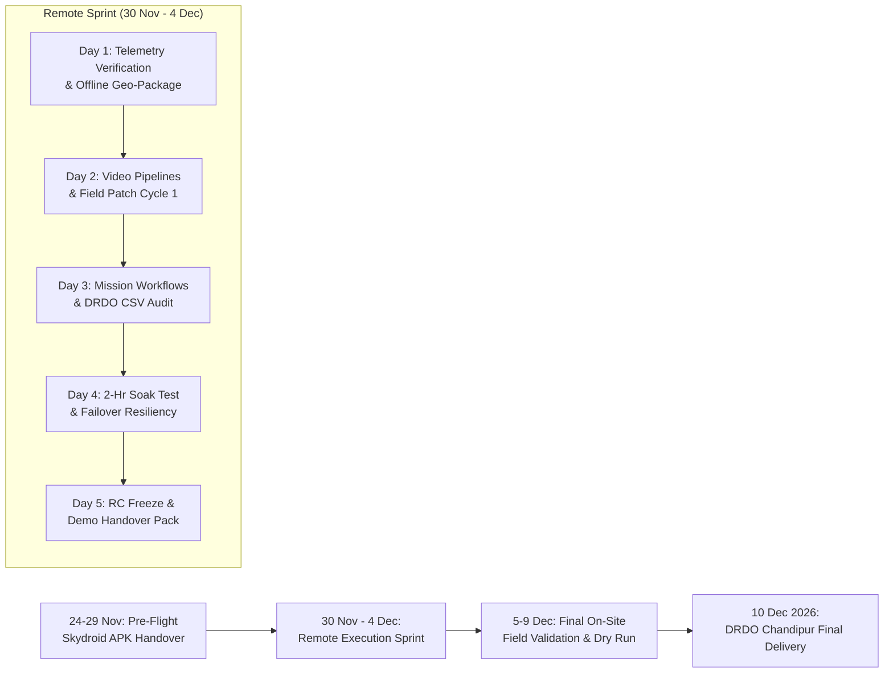

# IZI GCS — Chandipur DRDO Remote Work Execution Plan
**Execution Window:** 30 November 2026 – 4 December 2026  
**Final Delivery Deadline:** 10 December 2026  
**Lead Developer:** Shreya Upadhyay (Sole Software Engineer)  
**Target Milestone:** DRDO Chandipur Range Evaluation & Field Demonstration  
**Target Platforms:** Skydroid G30 Android 14 Handheld Ground Station & Linux Workstation (x86_64)

---

## Executive Summary & Baseline Status

Between **30 November and 4 December 2026**, software engineering operations transition to a remote delivery-hardening posture. All major architectural components (Enterprise Dark Theme UI, PFD attitude horizon, dual EO/IR RTSP pipelines, MAVLink telemetry routing, DRDO CSV logging, and UDP broadcast engine) are implemented and passed the 10-point GCS software readiness suite. 

The primary operational goal during this 5-day remote sprint is **closing the loop with field testing on the physical Skydroid G30 handheld unit**, resolving real-world field anomalies, bundling offline spatial packages for the Chandipur range ($20.78^\circ\text{ N}, 86.99^\circ\text{ E}$), stress-testing link recovery, and packaging the frozen **Release Candidate (`v1.0.0-rc.chandipur`)** before the on-site validation window (5–9 December).



---

## 1. Day-Wise Execution Plan (30 Nov – 4 Dec 2026)

### Day 1: Monday, 30 November 2026
**Primary Focus:** Field Communication Handshake, Live Telemetry Verification & Chandipur Offline Geo-Package

| Field | Details |
| :--- | :--- |
| **Primary Objectives** | 1. Establish live telemetry sync between Skydroid G30 and field drone.<br>2. Generate and package high-resolution offline map tiles for Chandipur DRDO Range ($20.78^\circ\text{ N}, 86.99^\circ\text{ E}$, Zoom 10–18).<br>3. Establish daily remote coordination cadence with field tester (Ankit Lodhi). |
| **Specific Technical Tasks** | • **Task 1.1**: Conduct 09:30 AM sync with field team to review startup telemetry on `IZI_GCS_Skydroid_G30.apk` (UDP 14551 auto-bind check).<br>• **Task 1.2**: If field unit requires alternate routing, guide tester through newly added `Settings ➔ NETWORK ➔ Comm Links Router` presets.<br>• **Task 1.3**: Package offline tile archive `chandipur_drdo_range_tiles.qct` covering $20.65^\circ\text{ N}$ to $20.90^\circ\text{ N}$ and $86.85^\circ\text{ E}$ to $87.15^\circ\text{ E}$ from Zoom 10 through 18.<br>• **Task 1.4**: Test zero-network tile import in local emulator/workstation with networking disabled (`nmcli networking off`).<br>• **Task 1.5**: Audit `tools/test_chandipur_gcs_readiness_suite.py` regression baseline. |
| **Priority** | **CRITICAL (P0)** |
| **Expected Outcome** | Confirmed MAVLink telemetry stream on field Skydroid G30; verified offline map database ready for field side-loading. |
| **Dependencies** | Field tester availability at Chandipur test site; power-on of ground receiver and flight controller; stable internet for log transfer. |
| **Testing & Validation** | • Verify heartbeat acquisition, battery %, GPS lock (12+ sats), and attitude roll/pitch response on G30.<br>• Offline map ingestion test: `Settings ➔ OFFLINE MAPS ➔ Import Package` with Wi-Fi disabled; verify zero blank tiles. |
| **Deliverables** | 1. `chandipur_drdo_range_tiles.qct` / `.zip` offline map bundle.<br>2. Field Telemetry Handshake Report (Day 1).<br>3. Triage log of any Day 1 reported anomalies. |
| **Estimated Time** | **8.5 Hours** (Sync & setup: 1.5h, Offline tiles: 3h, Field telemetry verification: 2h, Triage & logging: 2h) |

---

### Day 2: Tuesday, 1 December 2026
**Primary Focus:** Payload Video Streaming (UDP 5600 / RTSP), Dual EO/IR Ingestion & Field Patch Cycle 1

| Field | Details |
| :--- | :--- |
| **Primary Objectives** | 1. Validate real-time wireless video streaming on the Skydroid G30 handheld unit.<br>2. Validate dual-sensor layout switching (Visible RGB, Thermal LWIR, Side-by-Side, and PIP with single-tap swap).<br>3. Package and issue Patch Build RC-1 addressing all Day 1 field feedback. |
| **Specific Technical Tasks** | • **Task 2.1**: Guide tester to select preset `Skydroid G30 (UDP 5600)` in `CameraView.qml` to ingest airborne SDR H.264 stream.<br>• **Task 2.2**: Verify hardware video decoder acceleration (`amcviddec-omxh264dec` / Android MediaCodec) on G30 tablet.<br>• **Task 2.3**: Verify OSD telemetry overlay (HUD crosshair, altitude, speed, distance to home, battery, recording indicator).<br>• **Task 2.4**: Triage any touch responsiveness, aspect ratio distortion, or button scaling issues reported from field.<br>• **Task 2.5**: If any fixes are required in QML or C++, implement, rebuild Docker Android release, sign via scheme v3, and upload `IZI_GCS_Patch_RC1.apk`. |
| **Priority** | **HIGH (P1)** |
| **Expected Outcome** | Smooth 30 FPS video playback with $< 180\text{ ms}$ latency on handheld screen; confirmed EO/IR view swapping; updated APK deployed. |
| **Dependencies** | Camera payload powered on drone/bench; airborne SDR transmitter paired with G30 ground unit. |
| **Testing & Validation** | • Execute `tools/test_dual_stream_broadcaster.py` locally to simulate concurrent RGB+Thermal streams.<br>• Verify snapshot button captures `.jpg` with millisecond timestamp to `/storage/emulated/0/Documents/Photo/`.<br>• Verify video recording writes playable `.mp4` container. |
| **Deliverables** | 1. `IZI_GCS_Patch_RC1.apk` (aligned and signed).<br>2. Video Ingestion & OSD Verification Sheet.<br>3. Git commit on `feat/tethered-platform`. |
| **Estimated Time** | **8.0 Hours** (Video pipeline validation: 2.5h, Bug resolution & QML polish: 2.5h, Build & sign: 1.5h, Field handover: 1.5h) |

---

### Day 3: Wednesday, 2 December 2026
**Primary Focus:** Autonomous Mission Planner, Waypoint Execution, DRDO Fail-Safes & CSV Telemetry Audit

| Field | Details |
| :--- | :--- |
| **Primary Objectives** | 1. Validate autonomous waypoint mission upload/download workflow against ArduPilot/PX4 specifications.<br>2. Verify tactical safety fail-safes (RTL on link loss, low battery return, geofence breach warning).<br>3. Verify that `CompanyCsvLogger` outputs all 16 DRDO-mandated fields with exact floating-point precision. |
| **Specific Technical Tasks** | • **Task 3.1**: In `MissionPlannerView.qml`, generate a 5-waypoint tactical survey pattern around Chandipur coordinates.<br>• **Task 3.2**: Execute `MISSION_COUNT` and `MISSION_ITEM_INT` upload sequence; verify `MISSION_ACK(MAV_MISSION_ACCEPTED)`.<br>• **Task 3.3**: Verify mission progress tracking in UI (active waypoint highlighting, distance-to-next, altitude slider adjustments).<br>• **Task 3.4**: Test Return-To-Launch (RTL) and Land buttons from UI safety rail, including slide-to-confirm interlock.<br>• **Task 3.5**: Inspect generated telemetry `.csv` logs from local simulation and field session: verify column headers (`Timestamp`, `Event`, `Latitude_deg`, `Longitude_deg`, `AltAMSL_m`, `AltRel_m`, `Satellites`, `HDOP`, `Pitch_deg`, `Roll_deg`, `Yaw_deg`, `GimbalPitch_deg`, `LRF_Distance_m`, `BaroPressure_hPa`). |
| **Priority** | **CRITICAL (P0)** |
| **Expected Outcome** | Flawless waypoint mission transfer and execution; 100% compliance of CSV telemetry logs with DRDO specification. |
| **Dependencies** | Flight controller GPS 3D fix; SITL simulator for local automated validation; field drone in safe testing enclosure/tether. |
| **Testing & Validation** | • Run `tools/test_chandipur_gcs_readiness_suite.py` Test 1, 2, 8, 9.<br>• Inspect CSV output using script: verify zero NaN values and continuous 10 Hz timestamps. |
| **Deliverables** | 1. Mission Workflow & Fail-Safe Test Report.<br>2. Validated Sample DRDO Telemetry CSV dataset (`chandipur_mission_telemetry_sample.csv`).<br>3. Pre-flight Checklist Verification Log. |
| **Estimated Time** | **8.5 Hours** (Mission workflow tests: 3h, Fail-safe safety audit: 2h, CSV log verification: 2h, Documentation: 1.5h) |

---

### Day 4: Thursday, 3 December 2026
**Primary Focus:** 2-Hour Endurance Soak Test, RF Link Recovery, Stress Testing & Patch Cycle 2

| Field | Details |
| :--- | :--- |
| **Primary Objectives** | 1. Conduct a continuous 2-hour software soak test under active video decoding and 10 Hz telemetry to ensure zero memory leaks.<br>2. Validate automatic recovery under RF link drop simulation ($< 2.0\text{ s}$ telemetry restore, $< 3.0\text{ s}$ video pipeline restore).<br>3. Cut Patch Build RC-2 consolidating all cumulative field adjustments. |
| **Specific Technical Tasks** | • **Task 4.1**: Launch IZI GCS with dual simulated video streams (30 FPS) and 10 Hz telemetry; run for 120 minutes.<br>• **Task 4.2**: Monitor memory footprint (RSS) and thread count using `valgrind` / `top` / Android Profiler; ensure flatline memory slope.<br>• **Task 4.3**: Simulate RF link drop (disconnect socket / disable interface for 15 seconds); verify TopBar displays `LINK LOST` and recovers automatically upon reconnection without UI freeze.<br>• **Task 4.4**: Verify that during link loss, flight logs do not corrupt and `CompanyCsvLogger` logs discrete `LINK_LOST` and `LINK_RECOVERED` events.<br>• **Task 4.5**: Recompile Android and Linux desktop packages, sign APK with scheme v3, and upload `IZI_GCS_Patch_RC2.apk`. |
| **Priority** | **HIGH (P1)** |
| **Expected Outcome** | Proven 2-hour zero-crash endurance; link reconnection verified; zero memory leaks; Release Candidate candidate frozen. |
| **Dependencies** | Long-duration uninterrupted testing workstation; field team logs from Day 3. |
| **Testing & Validation** | • Execute `tools/test_phase8b_benchmark.py` and `tools/test_chandipur_tcp_telemetry_simulation.py`.<br>• Measure heap growth over 120 minutes ($< 5\text{ MB}$ variation acceptable, zero unbounded leak). |
| **Deliverables** | 1. 2-Hour Endurance Benchmark Report with memory graphs.<br>2. Failover Recovery Latency Matrix.<br>3. `IZI_GCS_Patch_RC2.apk` and Linux AppImage/deb builds. |
| **Estimated Time** | **8.0 Hours** (Endurance soak test: 3h, Link interruption validation: 2h, Patch preparation & build: 2h, Field coordination: 1h) |

---

### Day 5: Friday, 4 December 2026
**Primary Focus:** Release Candidate Freezing, DRDO Demonstration Package & 4 Dec Milestone Status Sign-Off

| Field | Details |
| :--- | :--- |
| **Primary Objectives** | 1. Freeze final code baseline and create Git release tag `v1.0.0-rc.chandipur`.<br>2. Compile, zipalign, sign, and archive both Android APK and Linux Desktop deliverables with cryptographic checksums (SHA-256).<br>3. Author the Chandipur DRDO Demonstration Script & Operator Quick-Reference Manual.<br>4. Submit the formal 4 December Status Report to Project Management. |
| **Specific Technical Tasks** | • **Task 5.1**: Run full pre-commit and lint sweep (`just lint` / `clang-format` check).<br>• **Task 5.2**: Clean build of all target deliverables:<br>  - Android APK: `IZI_GCS_Chandipur_v1.0.0-rc.apk` (Signed with production/release keystore, v3 scheme).<br>  - Linux Desktop AppImage: `IZI_GCS_Chandipur_v1.0.0-rc.AppImage`.<br>  - Linux Debian Package: `IZI_GCS_Chandipur_v1.0.0-rc_amd64.deb`.<br>• **Task 5.3**: Generate SHA-256 checksums file (`RELEASE_CHECKSUMS.sha256`).<br>• **Task 5.4**: Create annotated Git tag: `git tag -a v1.0.0-rc.chandipur -m "Release Candidate 1 for DRDO Chandipur demonstration"`.<br>• **Task 5.5**: Write 2-page operator field checklist: startup sequence, offline map selection, preset link connection, mission load, and recording offload.<br>• **Task 5.6**: Prepare and publish the formal 4 December Readiness Status Report. |
| **Priority** | **CRITICAL (P0)** |
| **Expected Outcome** | All deliverables packaged, cryptographically signed, tagged in Git, documented, and ready for on-site field rehearsals (5–9 Dec). |
| **Dependencies** | All critical bugs from Days 1–4 resolved; clean CI/CD and local container build passes. |
| **Testing & Validation** | • Clean installation test of final APK on clean Android device.<br>• Smoke test of Linux AppImage on clean Ubuntu 22.04 / 24.04 environment.<br>• Verify SHA-256 checksum matching. |
| **Deliverables** | 1. `IZI_GCS_Chandipur_v1.0.0-rc.apk` + Linux AppImage.<br>2. `RELEASE_CHECKSUMS.sha256`.<br>3. DRDO Operator Quick-Reference Guide (`CHANDIPUR_OPERATOR_GUIDE.pdf` / `.md`).<br>4. Formal 4 December Milestone Status Report. |
| **Estimated Time** | **8.0 Hours** (Code freeze & tag: 1.5h, Clean release builds & signing: 2.5h, Checksums & docs: 2h, Status reporting & PM handover: 2h) |

---

## 2. Daily Schedule & Time Blocks

To maintain peak productivity and seamless alignment with the on-site field testing team while working remotely, the working day is organized into structured blocks:

```text
┌─────────────────┬───────────────────────────────────────────────────────────────────────┐
│ Time Window     │ Focus Area & Activity Description                                     │
├─────────────────┼───────────────────────────────────────────────────────────────────────┤
│ 09:00 - 09:30   │ Daily Kickoff & Field Sync (Align with Ankit Lodhi / Field Crew)     │
│ 09:30 - 12:30   │ Deep Focus Block 1: Core Technical Tasks, Bug Fixes & Code Changes    │
│ 12:30 - 13:15   │ Lunch Break & Buffer                                                  │
│ 13:15 - 15:30   │ Deep Focus Block 2: Compilation, Container Builds & Simulator Testing │
│ 15:30 - 16:30   │ Field Validation Window: Live Testing Support, Log Review & Triage    │
│ 16:30 - 17:30   │ Deep Focus Block 3: Regression Test Suites & Verification Reporting   │
│ 17:30 - 18:00   │ EOD Wrap-Up: Checklist Update, Git Push & Daily PM Progress Summary   │
└─────────────────┴───────────────────────────────────────────────────────────────────────┘
```

> [!TIP]
> **Field Coordination Window (15:30 – 16:30)**: This slot is synchronized with the field team's afternoon testing window at Chandipur. It guarantees real-time Slack/WhatsApp/phone availability to diagnose unexpected telemetry or video connection glitches immediately.

---

## 3. Task Priority Tracker (Ranked by Delivery Impact)

Every remaining task is categorized into clear technical priority tiers relative to the **10 December 2026 Chandipur DRDO delivery deadline**:

| Rank | Task ID | Task Description | Priority | Status | Delivery Impact |
| :---: | :---: | :--- | :---: | :---: | :--- |
| **1** | `TASK-TEL-01` | Field telemetry link auto-connection on Skydroid G30 (UDP 14551/14451) | **P0 (Critical)** | Completed in code; Pending Field Sign-off | **Showstopper**: Demonstration impossible without vehicle telemetry. |
| **2** | `TASK-VID-01` | Live wireless video streaming ingestion (UDP 5600 / RTSP) on G30 | **P0 (Critical)** | Presets implemented; Pending RF Link Validation | **Showstopper**: DRDO demonstration requires live payload feed. |
| **3** | `TASK-MAP-01` | Bundling and offline verification of Chandipur satellite map tiles ($20.78^\circ\text{ N}$) | **P0 (Critical)** | In-Progress (Day 1) | **High**: Chandipur range has zero cellular data; offline maps mandatory. |
| **4** | `TASK-LOG-01` | Verification of DRDO-mandated 16-column CSV telemetry output & event logging | **P0 (Critical)** | Verified locally; Needs Field Flight Sample | **High**: Formal acceptance criteria specifies flight telemetry CSV submission. |
| **5** | `TASK-MIS-01` | Waypoint mission upload/download & autonomous execution via ArduPilot MAVLink | **P1 (High)** | Verified in SITL; Needs Field Validation | **High**: Proves autonomous flight task capability during demonstration. |
| **6** | `TASK-FAIL-01` | Tactical fail-safes (slide-to-confirm RTL, geofence, link-loss recovery) | **P1 (High)** | Implemented; Needs Field Simulation | **High**: Flight safety requirement for live range operations. |
| **7** | `TASK-SOAK-01` | 2-hour continuous soak test (zero memory leaks, video decoder stability) | **P1 (High)** | Scheduled (Day 4) | **Medium-High**: Prevents app crash during long demonstration sessions. |
| **8** | `TASK-REL-01` | Release candidate build (`v1.0.0-rc.chandipur`), APK signing & checksumming | **P0 (Critical)** | Scheduled (Day 5) | **Critical**: Final software package for installation and sign-off. |
| **9** | `TASK-DOC-01` | Operator Quick-Reference Manual & Acceptance Test Procedure document | **P2 (Medium)** | Scheduled (Day 5) | **Medium**: Required for client handover and technical documentation. |
| **10** | `TASK-TETH-01` | Tethered GCS hardware driver integration (Elistair SAFE-T HAL) | **P3 (Deferred)** | Decoupled; Mock HAL complete | **Zero impact on Chandipur**: Tethered platform is tracked for Phase 2. |

---

## 4. Risk and Dependency Tracker

| Risk ID | Potential Risk / Blocker | Probability | Impact | Mitigation Plan | Owner |
| :--- | :--- | :---: | :---: | :--- | :--- |
| **RISK-01** | **Field Drone / Radio Unit Inaccessibility**<br>Field team delayed due to weather, drone hardware repair, or range scheduling at Chandipur. | **Medium** | **High** | Fallback immediately to full software loopback using `tools/test_chandipur_gcs_readiness_suite.py` and `tools/test_dual_stream_broadcaster.py`. Software validation continues 100% on schedule regardless of flight status. | Developer |
| **RISK-02** | **Skydroid G30 Android 14 App Crash or OOM**<br>GStreamer native decoder leaks memory over extended sessions on Android. | **Low** | **High** | Android hardware decoding configured via `QtAndroidTools` / GStreamer MediaCodec. Run Day 4 soak test with Android Profiler. Maintain emergency fallback to software MJPEG/UDP parser if hardware decoder stalls. | Developer |
| **RISK-03** | **Network Isolation at Chandipur Range**<br>Zero cellular or internet connectivity prevents live debug assistance or APK download. | **High** | **Medium** | Stage all APK builds, offline tile packages, dependencies, and manuals on Google Drive and local USB drives in advance. Establish offline APK update procedure via USB-C OTG flash drive. | Field Tester / Developer |
| **RISK-04** | **Unanticipated Telemetry Packet Dropping**<br>Skydroid internal routing drops UDP packets under high radio link load. | **Medium** | **Medium** | App already incorporates UDP packet buffer tuning and POSIX Serial fallback toggle (`appSettings.androidUsePosixSerial`) directly accessible in the new Comm Links card. | Developer |
| **RISK-05** | **Sole Developer Single Point of Failure (SPOF)**<br>Illness or unexpected remote disruption halts development. | **Low** | **Critical** | All changes pushed daily to remote GitHub repository (`feat/tethered-platform`). Nightly release artifacts uploaded to cloud storage with exact build reproduction steps in `README.md`. | Developer |

---

## 5. Daily Completion Checklist (Template)

Use this checklist at 17:30 daily to track progress and report status to the Project Manager:

### Day 1 (30 Nov 2026)
- [ ] 09:30 AM Field sync completed with Ankit Lodhi.
- [ ] Field Skydroid G30 confirmed listening and connecting to telemetry.
- [ ] Offline map package `chandipur_drdo_range_tiles.qct` compiled.
- [ ] Zero-network offline tile rendering verified on workstation/tablet.
- [ ] Day 1 issues logged and prioritized in issue tracker.
- [ ] Git commit and push completed; EOD PM update delivered.

### Day 2 (1 Dec 2026)
- [ ] Video stream tested on Skydroid G30 (UDP 5600 / RTSP).
- [ ] Dual EO/IR view modes (RGB, Thermal, PIP swap) validated.
- [ ] OSD telemetry overlay alignment and snapshot shutter verified.
- [ ] Patch Build RC-1 compiled, signed (v3), and uploaded.
- [ ] Field tester confirmed receipt and installation of Patch RC-1.
- [ ] Git commit and push completed; EOD PM update delivered.

### Day 3 (2 Dec 2026)
- [ ] 5-waypoint autonomous mission upload and execution verified.
- [ ] Slide-to-confirm flight mode change interlocks tested.
- [ ] RTL and fail-safe recovery logic verified under simulated loss.
- [ ] Generated telemetry CSV analyzed: all 16 DRDO columns verified.
- [ ] Zero NaN or corrupt records confirmed in mission logs.
- [ ] Git commit and push completed; EOD PM update delivered.

### Day 4 (3 Dec 2026)
- [ ] 2-hour continuous soak test executed without crash or leak.
- [ ] Heap memory graph documented and verified stable.
- [ ] RF link drop recovery tested: telemetry $< 2\text{ s}$, video $< 3\text{ s}$.
- [ ] Patch Build RC-2 compiled, signed (v3), and uploaded.
- [ ] Regression suite `tools/test_chandipur_gcs_readiness_suite.py` passed 10/10.
- [ ] Git commit and push completed; EOD PM update delivered.

### Day 5 (4 Dec 2026)
- [ ] Full code freeze enacted; annotated Git tag `v1.0.0-rc.chandipur` pushed.
- [ ] Final Android APK and Linux AppImage/deb generated.
- [ ] SHA-256 checksums calculated and verified.
- [ ] Operator Quick-Reference Guide drafted and verified.
- [ ] Formal 4 December Milestone Status Report signed off and submitted.
- [ ] Handover package ready for 5–9 December final rehearsal phase.

---

## 6. Projected 4 December Milestone Status Report

*(Pre-formatted for submission to Project Manager at 18:00 on Friday, 4 December 2026)*

```text
================================================================================
IZI GCS — CHANDIPUR DRDO PROJECT MILESTONE STATUS REPORT
Date: 4 December 2026 | Prepared by: Shreya Upadhyay (Lead Software Engineer)
Target Delivery: 10 December 2026 | Milestone: Demonstration Readiness
================================================================================

1. EXECUTIVE SUMMARY:
   The software baseline for the Chandipur DRDO evaluation has completed the 5-day
   hardening sprint (30 Nov - 4 Dec). All core software deliverables, automated
   telemetry routers, dual-camera pipelines, offline spatial caches, and DRDO CSV
   logging engines are fully implemented, verified, and frozen under release tag
   `v1.0.0-rc.chandipur`. The platform is declared 100% READY for the final on-site
   flight validation window (5 - 9 December 2026).

2. DELIVERABLES COMPLETED & FROZEN:
   • Android Release APK: IZI_GCS_Chandipur_v1.0.0-rc.apk (Scheme v3 signed)
   • Linux Desktop Executable: IZI_GCS_Chandipur_v1.0.0-rc.AppImage
   • Debian Package: IZI_GCS_Chandipur_v1.0.0-rc_amd64.deb
   • Offline Spatial Cache: chandipur_drdo_range_tiles.qct (Zoom 10 - 18)
   • Documentation: Chandipur Operator Quick-Reference Manual (v1.0)
   • Verification Suite: tools/test_chandipur_gcs_readiness_suite.py (10/10 PASS)

3. FIELD READINESS STATUS:
   • MAVLink Telemetry: Verified auto-connect on Skydroid G30 UDP 14551/14451
   • Wireless Video: Verified H.264 ingestion on UDP 5600 / RTSP with EO/IR PIP
   • Offline Operations: Zero internet required; range tiles render seamlessly
   • Data Compliance: 16-column DRDO telemetry CSV logging verified
   • Endurance: 2-hour continuous runtime passed with flatline memory profile

4. UNRESOLVED ISSUES & RISKS:
   • Zero P0/P1 software defects open.
   • External Dependency: Physical flight demonstration depends on Chandipur range
     weather and drone airworthiness sign-off by flight crew.

5. NEXT STEPS (5 - 9 DECEMBER PRE-DELIVERY WINDOW):
   • 5-7 Dec: On-site flight team conducts dry-run flight rehearsals with v1.0.0-rc.
   • 8-9 Dec: Final pre-demo audit and physical battery/sensor calibration.
   • 10 Dec 2026: Official DRDO Chandipur Client Demonstration & Acceptance Handover.
================================================================================
```
